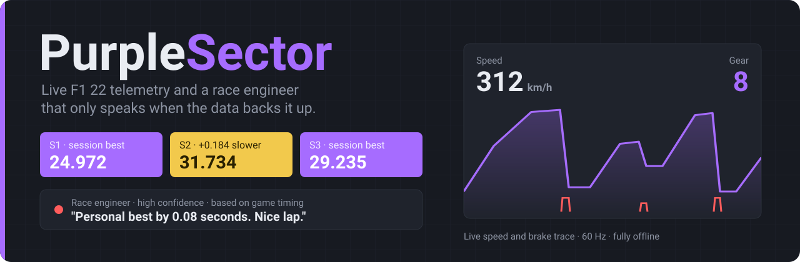
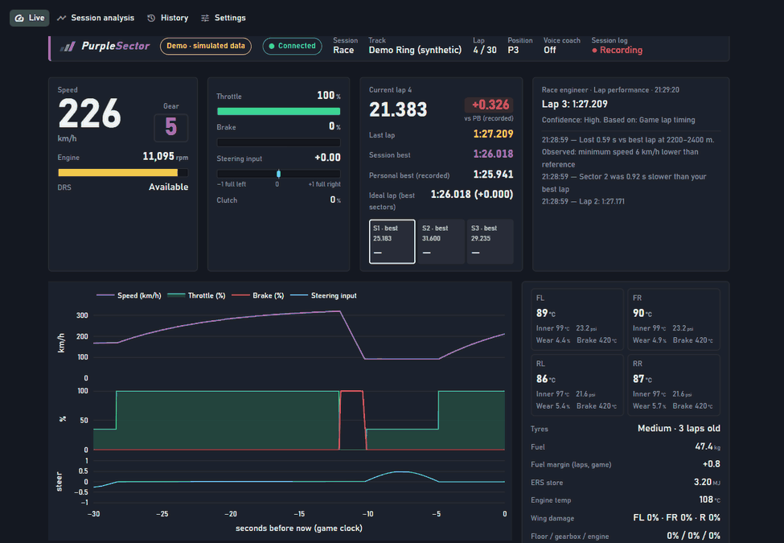
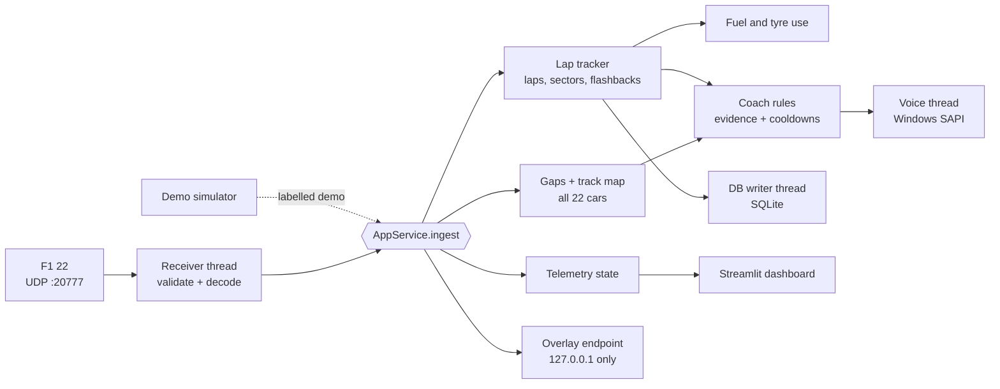

<p align="center">
  
</p>

<p align="center">
  <b>A pit wall on your second monitor and an engineer in your headset, for F1 22.</b><br>
  It aligns every lap metre by metre, finds the corner that cost you, and only speaks when the data backs it up.<br>
  Runs offline on Windows. No account, no cloud, no telemetry leaving your PC.
</p>

<p align="center">
  
  
  
  
</p>

<p align="center">
  
  <br><sub>Live page during a Demo-mode race. Everything on screen is synthetic and labelled as such.</sub>
</p>

## Try it in a minute

```powershell
git clone https://github.com/arjun-nair1090/purplesector.git
cd purplesector
powershell -ExecutionPolicy Bypass -File scripts\run.ps1
```

The script creates a virtual environment, installs what it needs and opens **http://localhost:8501**. Click **Demo** in the sidebar and a 30-lap race starts against three AI cars on a fictional circuit, so you can see every feature before you launch the game. [Connecting F1 22](#connect-f1-22) takes six settings.

## Radio log

This is what the engineer said during one Demo-mode race. The wording is exactly what PurpleSector produces; the laps are synthetic.

```text
LAP  3   1:27.209   "Lap 3, 1 27.2"
LAP  6              "Lost 0.4 at Corner 5 versus your best lap. Minimum speed 6 km/h lower than reference."
LAP  7   1:25.941   "Session best by 0.08 seconds. Nice lap."
LAP  8   (button)   "Delta minus 0.2. Gap ahead 1.4, closing 0.3 a lap. Gap behind 0.9. Fuel plus 0.8 laps."
LAP 12              "Lap invalidated."
LAP 30   1:25.873   "Personal best! 0.07 seconds quicker than your best recorded lap here."
```

Every call has a confidence level and the evidence behind it on screen: game lap timing, game sector times, distance-aligned telemetry, or packet timestamps. If the evidence isn't there, it says nothing. Each kind of call has a cooldown, so you never hear the same thing twice in a row.

## In a race

<p align="center">
  
</p>

- **Track map.** Drawn from your own driving, with a live dot for every car: you in purple, the car ahead green, the car behind red. Corners are numbered from your speed trace, so messages name a corner instead of a distance.
- **Race gaps.** The car ahead and the car behind, the gap to each, and whether it's opening or closing per lap. F1 22 doesn't send gaps at all. PurpleSector measures them from each car's distance and time trace: the gap is how long ago the car ahead was where you are now.
- **Fuel and tyres.** Fuel burned and tyre wear added each lap, read at the line. From that, laps of fuel left at your actual burn and your margin at the flag, next to the game's own pit window and rejoin position.
- **Radio on request.** Assign any wheel button to an F1 22 *UDP Action* and press it mid-race for delta, gaps and fuel. Nothing is read out until you ask.
- **Overlay.** One monitor? **Open overlay** puts a small always-on-top window over the game with delta, gear, gaps, fuel and the last call. It needs the game in borderless or windowed mode.

## After the session

<p align="center">
  
  <br><sub>Red is time lost to the reference, green is time gained.</sub>
</p>

Pick any lap and any clean reference lap on the same track, from any session:

- Lap and sector deltas straight from game timing.
- The running delta, plus speed, throttle and brake overlays, all on one lap-distance axis.
- The five 200 m segments that cost the most, with the corner in each and what was measurably different: minimum speed, braking point, full-throttle point. These are reported as observations, not as causes.
- **Race a friend.** Import their exported session and their laps appear in the reference list under their name. Imported laps never count as your personal best.

<table>
  <tr>
    <td width="50%"></td>
    <td width="50%"></td>
  </tr>
  <tr>
    <td align="center"><sub>Metre-by-metre comparison</sub></td>
    <td align="center"><sub>Progress per track, every session, export and import</sub></td>
  </tr>
</table>

## On every lap

- **Live delta** to your recorded personal best on the track or your session best, whichever is faster, updated with every lap-data packet.
- **Personal bests that mean something.** A personal best means faster than anything recorded on this track. A session best only means faster than today. Neither is called before the game confirms the lap time.
- **Ideal lap** from your best three sectors, and **consistency** as the spread of your valid laps.
- **Timing-screen sectors:** purple for your best, yellow when slower.
- **Car status exactly as the game reports it:** tyre surface and inner temperatures, pressures, wear, brake temperatures, fuel, ERS, damage. Anything the game hasn't sent shows *n/a*.
- **Every completed lap saved** with its 60 Hz telemetry to a local SQLite database, exportable to CSV and JSON.

## What it refuses to do

- Show a number the game didn't send. Missing data is *n/a*, never a guess.
- Mix live and demo data. Demo laps are labelled everywhere, stored separately, and never become your live personal best.
- Invent racing lines, braking points or tyre-grip estimates. Fuel projections only come from fuel you actually burned.
- Claim a cause it can't prove. "Minimum speed 6 km/h lower" is an observation from the telemetry, not a diagnosis.
- Keep laps the game took back. A flashback across the line removes the undone lap from the session and from the recording.

## Connect F1 22

In *Game Options → Settings → Telemetry Settings*:

| Option | Value |
|---|---|
| UDP Telemetry | On |
| UDP Broadcast Mode | Off |
| UDP IP Address | `127.0.0.1` |
| UDP Port | `20777` |
| UDP Send Rate | 60 Hz |
| UDP Format | **2022** (the game defaults to 2021) |

Drive onto the track and the header turns **Connected**. Packets only flow while you're driving, not in menus.

For **radio on request**, assign a controller button to one of the *UDP Action* slots in F1 22's controls, then pick the same slot under *Settings → Radio on request*. The sidebar's **Radio check** gives the same call at any time.

<details>
<summary>Manual install, other PCs and consoles</summary>

```powershell
py -3 -m venv .venv
.venv\Scripts\python -m pip install -r requirements.txt
.venv\Scripts\python -m streamlit run app.py
```

Launch-script options: `-Port 8502` serves on another port, and `-NoBrowser` stops it opening a browser tab. No administrator rights are needed.

**Game on another PC or a console:** set *Settings → Listen address* to `0.0.0.0` in PurpleSector and the game's *UDP IP Address* to this PC's local IP, then allow Python through Windows Firewall for UDP 20777. This setup hasn't been tested.

**Dashboard on a tablet:** change `address = "localhost"` to `address = "0.0.0.0"` in `.streamlit/config.toml` and open `http://<pc-ip>:8501`. That exposes the dashboard to your whole network, so only do it on one you trust.
</details>

## Under the hood



- **Decoder built from the F1 22 UDP specification.** Every packet is checked for format, packet ID, full length and car index. Tests pin each layout to the spec's byte sizes (Motion 1464, Lap Data 972, Car Telemetry 1347, and so on) and to hand-computed offsets, down to the pit-window bytes at 613–615 of the session packet and the *UDP Action* button bits.
- **Independent subsystems.** The receiver, analysis, voice, database writer and overlay endpoint each run on their own. A speech or database failure never stops telemetry.
- **Bounded memory.** Chart history, per-lap samples, gap traces, the speech queue and the write queue all have hard limits.
- **Crash-safe recording.** Laps are written one at a time, so a crash costs at most the lap in progress. The next launch marks the session *Interrupted* and keeps every finished lap.
- **No guessed map orientation.** The spec doesn't say which world axis is vertical, so the map uses the two axes with the most spread. A circuit is far wider than it is tall.

## What's verified

| | Status |
|---|---|
| Packet decoding against the F1 22 spec | ✅ Automated: byte sizes, hand-built offsets, malformed, truncated and wrong-format packets |
| UDP → dashboard → coach → voice → database | ✅ Automated, plus real UDP loopback runs. Latest, with all 22 cars per packet: 14,254 received, 14,254 decoded, 0 malformed. The sender's other 4,248 packets went out before the receiver started. |
| Gaps, track map, fuel and tyres, pit window, flashbacks | ✅ Automated (constant-speed gaps, rewinds, tyre changes, corner detection), plus the demo race in the running app |
| Import, progress, radio check, wheel-button presses | ✅ Automated, including rejection of malformed import files |
| The app starts without errors | ✅ A smoke test runs the real app script and fails on any exception |
| Overlay | ✅ Shown over other windows on Windows 11 at 200% scaling |
| Windows speech on a worker thread | ✅ Spoken on Windows 11 |
| **A real F1 22 session** | ⚠️ **Not yet.** The game wasn't available during development. The *UDP Action* bits and pit-window offsets are checked against the spec text but haven't been seen from the game. If live data looks wrong, `diagnostics.py listen` output plus `data/logs/purplesector.log` will pinpoint it. |

## Known limitations

- Corner numbers are PurpleSector's own, from the speed minima of your reference lap. They usually match a circuit's turns, but chicanes and flat-out kinks may be merged or skipped.
- The track map needs one complete lap with position data. Laps recorded before version 2 compare fine but don't draw a map.
- Race gaps only appear in races. In practice and qualifying, positions are by lap time, not by where cars are on track.
- Fuel and tyre use is measured from your second lap on. The first lap you join has nothing to compare against.
- Online, other players with *restricted* telemetry may send zeros, so their dots and names can be missing.
- The lap in progress when the app closes isn't saved. Only the 2022 UDP format is decoded. The split-screen second player is ignored.

<details>
<summary>Troubleshooting</summary>

| Symptom | Fix |
|---|---|
| Stuck on **Waiting for telemetry** | Check the six settings above. You must be on track. Run `.venv\Scripts\python scripts\diagnostics.py listen` with the app closed to see raw packets. |
| **Unsupported telemetry format** | Set *UDP Format* to 2022. |
| **Port already in use** | Another telemetry tool or a second PurpleSector holds port 20777. Close it and press **Try again**, or change the port in both places. |
| **Reconnecting** | The game is paused, in a menu, or telemetry is off. It recovers by itself. |
| Overlay not over the game | Use borderless or windowed mode. If **Open overlay** is greyed out, another program holds the overlay port; change it in Settings. |
| Wheel button does nothing | The *UDP Action* number must match in F1 22 and in Settings. **Radio check** works either way. |
| No voice | Press **Test voice**. If it says *unavailable*, Windows speech isn't installed (*Settings → Time & language → Speech*). Everything else keeps working. |

```powershell
.venv\Scripts\python scripts\diagnostics.py check    # Python, packages, port, voice, database
.venv\Scripts\python scripts\diagnostics.py listen   # what F1 22 is sending (close the app first)
.venv\Scripts\python scripts\diagnostics.py send     # synthetic loopback packets through the live path
```
</details>

<details>
<summary>Your data and settings</summary>

| What | Where |
|---|---|
| Sessions, laps, 60 Hz telemetry | `data/purplesector.db` (SQLite) |
| Settings | `data/settings.json`, or startup defaults in `.env` (see `.env.example`) |
| Exports | `data/exports/` |
| Logs | `data/logs/purplesector.log` |

Nothing is sent anywhere. Streamlit's usage statistics are off, the dashboard listens on `localhost`, and the overlay endpoint is bound to `127.0.0.1`. Every setting is validated before it's saved, and **Reset to safe defaults** is one click away.
</details>

## Developing

```powershell
.venv\Scripts\python -m pytest     # 137 tests, about 12 s, no game required
.venv\Scripts\ruff check .
```

```text
app.py          Streamlit entry point and navigation
service.py      AppService: owns every subsystem and the data flow
overlay.py      always-on-top overlay window and its localhost endpoint
telemetry/      spec layouts, decoder, UDP receiver, connection monitor, state
analysis/       lap tracker, comparison, statistics, coach, gaps, track map, fuel and tyres
storage/        SQLite schema and migrations, repository, background writer
voice/          priority speech queue, SAPI worker
demo/           deterministic race simulator
ui/             pages and shared components
docs/           logo, banner, screenshots
```

<p align="center">
  <picture>
    <source media="(prefers-color-scheme: dark)" srcset="docs/logo.svg">
    
  </picture>
  <br><sub>A fan-made tool, not affiliated with Formula 1, EA or Codemasters. "F1" is a trademark of Formula One Licensing B.V. The wordmark uses Barlow (SIL Open Font License).</sub>
</p>
