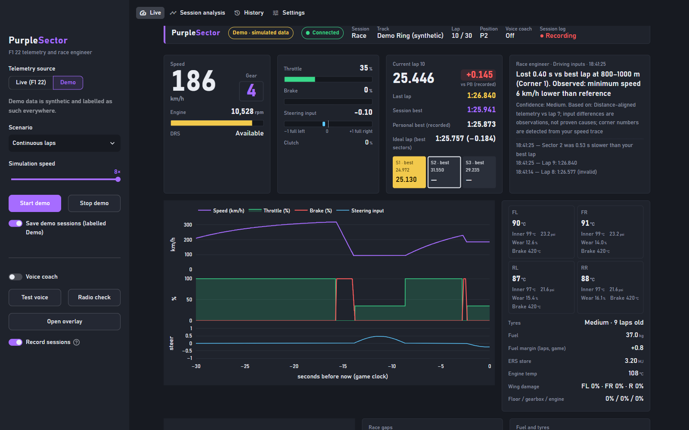
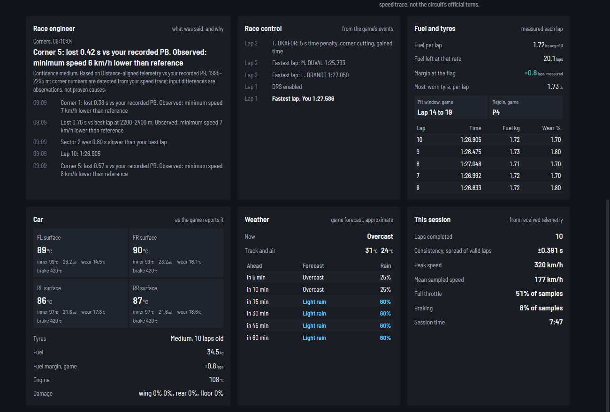
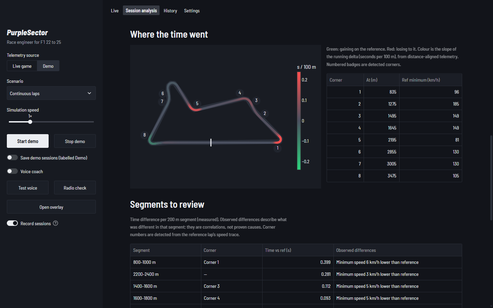
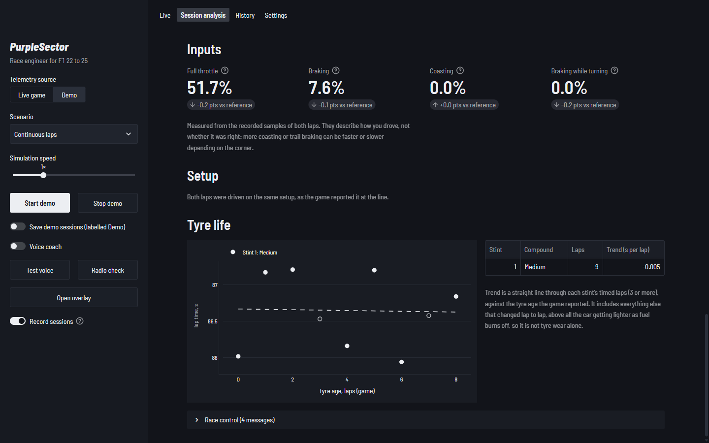
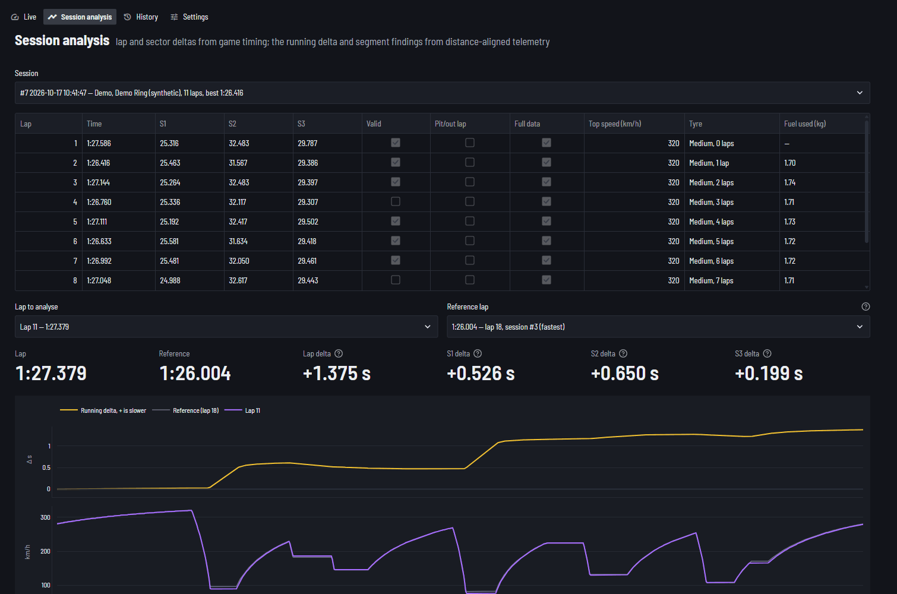
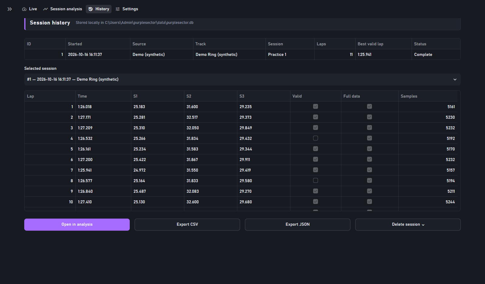
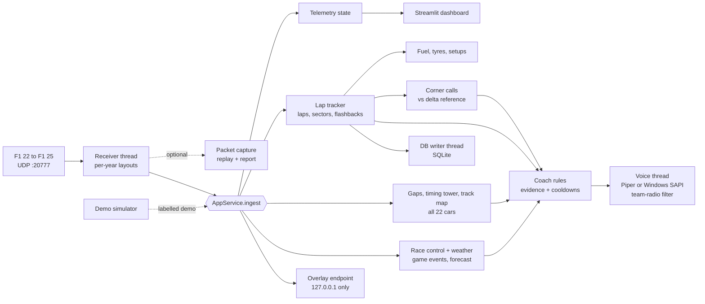

<picture>
  <source media="(prefers-color-scheme: dark)" srcset="docs/wordmark-dark.png">
  
</picture>

A pit wall on your second monitor and an engineer in your headset, for F1 22 to F1 25. It lines up every lap metre by metre, tells you which corner cost you before you reach the next one, and only speaks when the data backs it up. Runs offline on Windows; no account, no cloud.

[](https://github.com/arjun-nair1090/purplesector/actions/workflows/ci.yml)



The live page in a Demo-mode race. Everything on it is synthetic and labelled as such.

## Try it in a minute

**Download:** get `PurpleSector-windows.zip` from [Releases](https://github.com/arjun-nair1090/purplesector/releases), unzip it anywhere and run `PurpleSector.exe`. No Python, no installer, no admin rights. Sessions are saved in a `data` folder next to the exe.

**From source:**

```powershell
git clone https://github.com/arjun-nair1090/purplesector.git
cd purplesector
powershell -ExecutionPolicy Bypass -File scripts\run.ps1
```

Either way the dashboard opens at **http://localhost:8501**. Click **Demo** in the sidebar and a 30-lap race starts against three AI cars on a fictional circuit, so you can see every feature before you launch the game. [Connecting the game](#connect-the-game) takes six settings.

## Radio log

This is what the engineer said in the first twelve laps of a Demo-mode race, copied from the app's output. The laps are synthetic; the words are what PurpleSector says. Recurring calls rotate between a few phrasings, so another run won't repeat them word for word.

```text
LAP  1   forecast      "Rain expected in 30 minutes, 60 percent."
LAP  1   position      "Good job, that's P2."
LAP  2   at the line   "Okafor a tenth behind, within a second."
LAP  2   corner 5      "Corner 5, lost 5 tenths. Minimum speed 6 lower."
LAP  3   at the line   "Lost 9 tenths in sector 2."
LAP  4   at the line   "P3. Gap behind 1.5 to Brandt, closing 2 tenths a lap."
LAP  4   track limits  "Lap invalidated."
LAP  5   position      "Up to P2."
LAP  8   at the line   "That's your best of the session, up a tenth."
LAP 10   at the line   "P2. Gap ahead 11.0 to Duval, opening 1.1 a lap. Gap behind 1.4 to Okafor."
LAP 11   at the line   "Okafor 9 tenths behind, within a second, and closing."
LAP 12   position      "Lost the place, P3."
```

Every call shows its confidence and the evidence behind it: game lap timing, game sector times, the game's forecast, distance-aligned telemetry or packet timestamps. If the evidence isn't there, it says nothing. Each kind of call has a cooldown, corner calls are capped at three a lap, and every kind can be switched off.

## In a race

<p align="center">
  
</p>

- **Pit board.** Your position, the gap that matters and the lap, in figures you can read at a glance from the cockpit. In a race that's the car ahead, and whether you're closing or losing per lap. In qualifying it's how far you are off the fastest lap.
- **Timing tower.** Every car in order with its team colour, its best lap (purple for the fastest) and the interval to the car ahead. F1 23 and later send that interval. For F1 22 PurpleSector measures it from each car's distance trace: how long ago the car ahead was where this one is now.
- **You against the fastest.** Your best S1, S2, S3 and lap against the session's fastest, with who set each, from the game's own lap history. Your live sectors go purple when they beat everyone and green when they beat your own best.
- **Corner calls.** Lose time in a corner and before the next one the engineer says how much and what was different there: "Corner 4, lost 2 tenths. Braked 11 metres earlier." Corners are numbered from your own speed trace and compared with your delta reference on lap distance.
- **Race control.** Penalties with the infringement, safety cars and VSCs, red flags, retirements, fastest laps, and overtakes and contact involving you, all from the game's event packets. Your penalties, safety cars and red flags are read out.
- **Weather.** The game's forecast for the session, and a call when it shows the track going wet or drying: once when it first appears and again five minutes out.
- **Track map.** Drawn from your own driving, with a live dot for every car: you in white, the cars either side of you in grey (ahead filled, behind open).
- **Fuel and tyres.** Fuel burned and tyre wear added each lap, read at the line. From that, laps of fuel left at your actual burn and your margin at the flag, next to the game's own pit window and rejoin position.
- **Race radio.** In a race the engineer calls what you'd want to hear without asking: places gained or lost once they've settled, a car within a second ahead or behind, the gaps either side every few laps, five to go and the last lap, tyre wear passing 50 and 70 percent, fuel going short at your measured burn, the game's pit window, blue and yellow flags, new wing damage, and where you finished. The line calls for a lap come as one message, not a string of them.
- **Radio on request.** Assign any wheel button to a *UDP Action* in the game and press it mid-race for position, laps to go, delta, gaps, fuel and tyres.
- **The engineer's voice.** Pick it in the sidebar, with its own volume. Five neural voices (British, Scottish and American, from the [Piper](https://github.com/OHF-Voice/piper1-gpl) voice library) sound like a person and run offline after a one-time 61 MB download each; the Windows voices are always there as well. Every call comes through a team-radio channel, band-limited and compressed with the click of the channel opening and closing, which you can switch off in Settings. Give the engineer your name and it uses it now and then. Neural voices need running from source; the exe speaks with the Windows voices.
- **Overlay.** One monitor? **Open overlay** puts a small always-on-top window over the game with delta, gear, gaps, fuel and the last call. It needs the game in borderless or windowed mode.

## After the session

<p align="center">
  
  <br><sub>Red is time lost to the reference, green is time gained.</sub>
</p>

Pick any lap and any clean reference lap on the same track, from any session:

- Lap and sector deltas straight from game timing.
- The running delta, plus speed, throttle, brake and steering overlays, all on one lap-distance axis.
- The five 200 m segments that cost the most, with the corner in each and what was measurably different: minimum speed, braking point, full-throttle point, distance spent coasting. These are reported as observations, not as causes.
- **Inputs.** Full throttle, braking, coasting, and braking while turning (a trail-braking indicator), for both laps side by side.
- **Setup.** Every setting that differs between the two laps, as the game reported each car setup at the line.
- **Tyre life.** Lap time against tyre age for every stint, with the trend in seconds per lap. It includes the car getting lighter as fuel burns off, and the page says so.
- **Race a friend.** Import their exported session and their laps appear in the reference list under their name. Imported laps never count as your personal best.

<p align="center">
  
  <br><sub>Segments, inputs, setup and tyre life. The trend line is labelled for what it is: tyre age and fuel burn together.</sub>
</p>

<table>
  <tr>
    <td width="50%"></td>
    <td width="50%"></td>
  </tr>
  <tr>
    <td align="center"><sub>Metre-by-metre comparison</sub></td>
    <td align="center"><sub>Progress per track, every session, export and import</sub></td>
  </tr>
</table>

## On every lap

- **Live delta** to your recorded personal best on the track or your session best, whichever is faster, updated with every lap-data packet.
- **Personal bests that mean something.** A personal best means faster than anything recorded on this track. A session best only means faster than today. Neither is called before the game confirms the lap time.
- **Ideal lap** from your best three sectors, and **consistency** as the spread of your valid laps.
- **Timing-screen sectors:** purple for the session's fastest, green for your best, yellow when slower.
- **Car status exactly as the game reports it:** tyre surface and inner temperatures, pressures, wear, brake temperatures, fuel, ERS, damage. Anything the game hasn't sent shows *n/a*.
- **Every completed lap saved** with its 60 Hz telemetry to a local SQLite database, exportable to CSV and JSON.

## What it refuses to do

- Show a number the game didn't send. Missing data is *n/a*, never a guess.
- Mix live and demo data. Demo laps are labelled everywhere, stored separately, and never become your live personal best.
- Invent racing lines, braking points or tyre-grip estimates. Fuel projections only come from fuel you actually burned.
- Claim a cause it can't prove. "Minimum speed 6 km/h lower" is an observation from the telemetry, not a diagnosis.
- Keep laps the game took back. A flashback across the line removes the undone lap from the session and from the recording.

## Connect the game

In F1 22, F1 23, F1 24 or F1 25, open *Settings → Telemetry Settings*:

| Option | Value |
|---|---|
| UDP Telemetry | On |
| UDP Broadcast Mode | Off |
| UDP IP Address | `127.0.0.1` |
| UDP Port | `20777` |
| UDP Send Rate | 60 Hz |
| UDP Format | The game's own year: **2022**, **2023**, **2024** or **2025** |

PurpleSector reads the format from every packet, so there is nothing to set on its side. Drive onto the track and the header turns **Connected**. Packets only flow while you're driving, not in menus.

For **radio on request**, assign a controller button to one of the *UDP Action* slots in the game's controls, then pick the same slot under *Settings → Radio on request*. The sidebar's **Radio check** gives the same call at any time.

<details>
<summary>Manual install, other PCs and consoles</summary>

```powershell
py -3 -m venv .venv
.venv\Scripts\python -m pip install -r requirements.txt
.venv\Scripts\python -m streamlit run app.py
```

Launch-script options: `-Port 8502` serves on another port, and `-NoBrowser` stops it opening a browser tab. No administrator rights are needed.

**Game on another PC or a console:** set *Settings → Listen address* to `0.0.0.0` in PurpleSector and the game's *UDP IP Address* to this PC's local IP, then allow Python through Windows Firewall for UDP 20777. This setup hasn't been tested.

**Dashboard on a tablet:** change `address = "localhost"` to `address = "0.0.0.0"` in `.streamlit/config.toml` and open `http://<pc-ip>:8501`. That exposes the dashboard to your whole network, so only do it on one you trust.
</details>

## Under the hood



- **One decoder, four games.** Each year's layout is F1 22's with that year's changes written out: the 29-byte header from F1 23 on, sector times split into milliseconds and minutes, the renumbered session types of F1 24, the shorter driver names of F1 25. All four decode into the same records, so nothing past the decoder knows which game is running. Tests pin every layout to the byte sizes each year's spec publishes (Lap Data 972, 1131, 1285 and 1285, and so on) and to hand-built packets, and check that newer packet types count as unused, not as errors.
- **Independent subsystems.** The receiver, analysis, voice, database writer and overlay endpoint each run on their own. A speech or database failure never stops telemetry.
- **Bounded memory.** Chart history, per-lap samples, gap traces, the speech queue and the write queue all have hard limits.
- **Crash-safe recording.** Laps are written one at a time, so a crash costs at most the lap in progress. The next launch marks the session *Interrupted* and keeps every finished lap.
- **No guessed map orientation.** The spec doesn't say which world axis is vertical, so the map uses the two axes with the most spread. A circuit is far wider than it is tall.

## What's verified

| | Status |
|---|---|
| Packet decoding against the F1 22, 23, 24 and 25 specs | ✅ Automated: every year's byte sizes, hand-built packets, malformed, truncated and unsupported-format packets |
| UDP → dashboard → coach → voice → database | ✅ Automated, plus real UDP loopback runs. Latest, with all 22 cars per packet: 14,254 received, 14,254 decoded, 0 malformed. The sender's other 4,248 packets went out before the receiver started. |
| Gaps, track map, fuel and tyres, pit window, flashbacks | ✅ Automated (constant-speed gaps, rewinds, tyre changes, corner detection), plus the demo race in the running app |
| Import, progress, radio check, wheel-button presses | ✅ Automated, including rejection of malformed import files |
| The app starts without errors | ✅ A smoke test runs the real app script and fails on any exception |
| Overlay | ✅ Shown over other windows on Windows 11 at 200% scaling |
| Corner calls, race control, weather, field timing, setups, tyre life | ✅ Automated against synthetic laps and events, plus the demo race in the running app |
| `PurpleSector.exe` | ✅ Built with PyInstaller and run: dashboard, demo race, fonts and overlay, with data saved next to the exe |
| Python 3.11 and 3.14 | ✅ The whole suite on both locally; CI runs 3.11 and 3.13 on Windows |
| Windows speech on a worker thread | ✅ Spoken on Windows 11 |
| **A real game session, any year** | ⚠️ **Not yet.** None of the games was available during development, so the layouts match the published specs but haven't been checked against packets from a game. Drive a few laps with **Capture raw packets** on (Live page, Diagnostics) and `diagnostics.py report` shows exactly what decoded and what didn't. |

## Known limitations

- Corner numbers are PurpleSector's own, from the speed minima of your reference lap. They usually match a circuit's turns, but chicanes and flat-out kinks may be merged or skipped.
- The track map needs one complete lap with position data. Laps recorded before version 2 compare fine but don't draw a map.
- Race gaps only appear in races. In practice and qualifying, positions are by lap time, not by where cars are on track, so the tower shows the gap to the fastest lap instead.
- Corner calls and the segment table compare against one reference lap. A corner where a different line is faster still reads as a loss. Corner calls stay quiet on pit and out laps and behind a safety car.
- Fuel and tyre use is measured from your second lap on. The first lap you join has nothing to compare against.
- Online, other players with *restricted* telemetry may send zeros, so their dots and names can be missing.
- The lap in progress when the app closes isn't saved. Formats older than 2022 aren't decoded. The split-screen second player is ignored.
- Team colours cover the ten F1 teams of each game. F2, classic cars and My Team get a neutral bar.

<details>
<summary>Troubleshooting</summary>

| Symptom | Fix |
|---|---|
| Stuck on **Waiting for telemetry** | Check the six settings above. You must be on track. Run `.venv\Scripts\python scripts\diagnostics.py listen` with the app closed to see raw packets. |
| **Unsupported telemetry format** | Set *UDP Format* to the game's own year, 2022 to 2025. |
| **Port already in use** | Another telemetry tool or a second PurpleSector holds port 20777. Close it and press **Try again**, or change the port in both places. |
| **Reconnecting** | The game is paused, in a menu, or telemetry is off. It recovers by itself. |
| Overlay not over the game | Use borderless or windowed mode. If **Open overlay** is greyed out, another program holds the overlay port; change it in Settings. |
| Wheel button does nothing | The *UDP Action* number must match in the game and in Settings. **Radio check** works either way. |
| No voice | Press **Test voice**. If it says *unavailable*, Windows speech isn't installed (*Settings → Time & language → Speech*). Everything else keeps working. |
| Voice sounds robotic | A neural voice that isn't downloaded yet falls back to the Windows voice: the sidebar says so under the picker and offers the download. |

```powershell
.venv\Scripts\python scripts\diagnostics.py check    # Python, packages, port, voice, database
.venv\Scripts\python scripts\diagnostics.py listen   # what the game is sending (close the app first)
.venv\Scripts\python scripts\diagnostics.py send     # synthetic loopback packets through the live path
.venv\Scripts\python scripts\diagnostics.py report data\captures\FILE.pscap.gz   # what a capture contains
.venv\Scripts\python scripts\diagnostics.py replay data\captures\FILE.pscap.gz   # play it back into the app
```

With the downloaded exe, the same commands are `PurpleSector.exe check`, `PurpleSector.exe report FILE` and so on, run from a terminal in its folder.
</details>

<details>
<summary>Your data and settings</summary>

| What | Where |
|---|---|
| Sessions, laps, 60 Hz telemetry | `data/purplesector.db` (SQLite) |
| Settings | `data/settings.json`, or startup defaults in `.env` (see `.env.example`) |
| Exports | `data/exports/` |
| Packet captures | `data/captures/`, only while you have capture on |
| Logs | `data/logs/purplesector.log` |

Nothing is sent anywhere. Streamlit's usage statistics are off, the dashboard listens on `localhost`, and the overlay endpoint is bound to `127.0.0.1`. Every setting is validated before it's saved, and **Reset to safe defaults** is one click away.
</details>

## Developing

```powershell
.venv\Scripts\python -m pytest     # 231 tests, about 25 s, no game required
.venv\Scripts\ruff check .
powershell -ExecutionPolicy Bypass -File scripts\build_exe.ps1   # dist\PurpleSector-windows.zip
```

Pushing a `v*` tag runs the tests on GitHub and attaches a freshly built `PurpleSector-windows.zip` to a release.

```text
app.py          Streamlit entry point and navigation
service.py      AppService: owns every subsystem and the data flow
overlay.py      always-on-top overlay window and its localhost endpoint
telemetry/      records, per-year layouts, decoder, UDP receiver, packet capture, state
analysis/       lap tracker, comparison, coach, corner calls, race radio, gaps, field timing, race control,
                weather, track map, fuel and tyres, setups, tyre life
storage/        SQLite schema and migrations, repository, background writer
voice/          priority speech queue, Piper and SAPI voices, team-radio filter
demo/           deterministic race simulator
ui/             pages and shared components
static/         bundled Barlow font files (SIL Open Font License)
packaging/      PyInstaller launcher and spec for PurpleSector.exe
docs/           wordmark and screenshots (scripts/make_brand.py rebuilds the logo files)
```

<sub>A fan-made tool, not affiliated with Formula 1, EA or Codemasters. "F1" is a trademark of Formula One Licensing B.V. The wordmark uses Barlow (SIL Open Font License).</sub>
