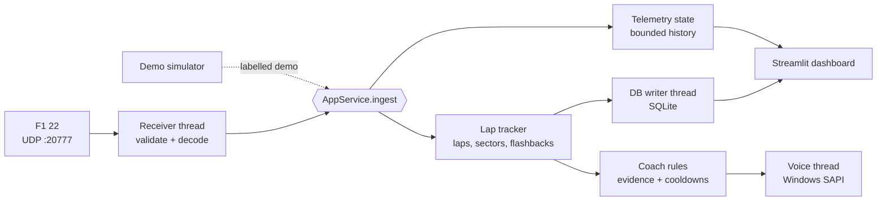

<p align="center">
  
</p>

<p align="center">
  
  
  
  
  
</p>

<h3 align="center">Stop guessing where the lap went.<br>Put PurpleSector on your second monitor and find out.</h3>

---

You know the feeling. The lap felt mega, the timer says otherwise, and the game won't tell you why.

**PurpleSector** listens to F1 22's telemetry feed and turns it into a live pit-wall screen and a race engineer on your headset. It doesn't stop at lap times. It lines up your laps metre by metre, finds the 200 m where the time actually went, and tells you what was different there. It runs entirely on your PC, needs no account and no internet, and never makes things up.

<p align="center">
  
  <br><sub>Live dashboard, shown here in Demo mode with simulated data</sub>
</p>

## Why it's different

| | |
|---|---|
| **🟪 Timing-screen sectors** | Each sector lights up like the real timing tower: purple for your session best, yellow when you're slower. You can read it at a glance from the cockpit. |
| **🎧 A race engineer, not a chatterbox** | Short radio calls over offline Windows speech. Personal bests, invalidated laps, the sector that cost you, and the corner where you lost the most time. If the evidence isn't there, it stays quiet. |
| **📏 Metre-by-metre lap comparison** | Two laps are aligned on lap distance, not time, so the running delta shows exactly where you gained and lost. Pick any clean lap from any session on the same track as the reference. |
| **📊 Proper telemetry traces** | Speed, throttle, brake and steering scroll live. Compare laps with speed, throttle and brake overlays plus a delta line. |
| **🛞 Car status you can trust** | Tyre surface and inner temperatures, pressures, wear, brake temperatures, fuel, ERS and damage, exactly as the game reports them. Anything the game hasn't sent shows **n/a**, never a made-up number. |
| **💾 Every lap saved** | Completed laps and their telemetry go into a local SQLite database. Browse sessions, compare them, and export to CSV or JSON. |
| **🎮 Demo mode** | A built-in simulator laps a fictional "Demo Ring" so you can explore everything before you even launch the game. It is labelled as simulated everywhere. |

## Your engineer only says what it can prove

Every message comes with a confidence level and the evidence behind it, shown on screen. Here is the complete list of calls:

| Radio call | When you hear it | Based on |
|---|---|---|
| *"Personal best by 0.31 seconds. Nice lap."* | A **valid** lap beats your previous best valid lap this session | Game lap timing |
| *"Lap 7, 1 25.9"* | Every completed lap | Game lap timing |
| *"Lap invalidated."* | The game flags your current lap invalid | Game lap-invalid flag |
| *"Sector 2 was 0.4 slower than your best."* | A valid lap's worst sector is ≥ 0.25 s off your best lap | Game sector times |
| *"Lost 0.4 around 2200 metres versus your best lap. Minimum speed 6 km/h lower than reference."* | A distance-aligned comparison is conclusive and a 200 m segment lost ≥ 0.15 s | Aligned telemetry. Input differences are reported as observations, not as proven causes. |
| *"Brake input is unusually abrupt compared with your previous laps."* | Your median brake build-up time drops below 60% of your recent laps' average | Brake samples from at least 2 earlier clean laps |
| *"Telemetry lost."* | Packets stop for 2 s after being connected | Packet timestamps |
| Pit entry/exit, session start/end | Only at *Detailed* verbosity | Game pit status and events |

It **won't** invent braking points, racing lines, tyre-grip estimates or fuel predictions. It won't call a personal best before the game confirms the lap time, and it won't repeat itself (each message type has a cooldown). Every threshold above can be changed on the Settings page.

## 60-second setup

**1. Launch PurpleSector** (Windows PowerShell, from the project folder):

```powershell
powershell -ExecutionPolicy Bypass -File scripts\run.ps1
```

On the first run this creates a virtual environment in `.venv`, installs the dependencies, and opens the dashboard at **http://localhost:8501**.

**2. Turn on telemetry in F1 22.** Go to *Game Options → Settings → Telemetry Settings*:

| Option | Value |
|---|---|
| UDP Telemetry | **On** |
| UDP Broadcast Mode | Off |
| UDP IP Address | `127.0.0.1` |
| UDP Port | `20777` |
| UDP Send Rate | **60 Hz** |
| UDP Format | **2022** |

**3. Drive.** As soon as you're on track, the header pill turns green and reads **Connected**. Packets only flow while you're driving, not in menus.

> **No game handy?** Click **Demo** in the sidebar. The simulator starts lapping straight away, and you can pick a scenario: continuous laps, a lap completed in about 15 s, or a telemetry drop-out.

<details>
<summary><b>Manual install (if you prefer)</b></summary>

```powershell
py -3 -m venv .venv
.venv\Scripts\python -m pip install -r requirements.txt
.venv\Scripts\python -m streamlit run app.py
```

You don't need to activate the venv. If you want to and `Activate.ps1` is blocked, run `Set-ExecutionPolicy -Scope CurrentUser RemoteSigned` once, or keep using the launch script with `-ExecutionPolicy Bypass`. No administrator rights are needed.

Launch-script options: `-Port 8502` serves on another port, and `-NoBrowser` stops it opening a browser tab.
</details>

<details>
<summary><b>Playing on a console or a second PC?</b></summary>

F1 22 can send telemetry across your network. In PurpleSector, set *Settings → Listen address* to `0.0.0.0`. In the game, set *UDP IP Address* to the PC's local IP (for example `192.168.1.20`). Allow Python through Windows Firewall for UDP 20777 when prompted. *(This setup hasn't been tested.)*

To view the dashboard on a tablet, change `address = "localhost"` to `address = "0.0.0.0"` in `.streamlit/config.toml` and open `http://<pc-ip>:8501`. That exposes the dashboard to your whole network, so only do it on a network you trust.
</details>

## Find the time

<p align="center">
  
  <br><sub>Session analysis: any lap against the fastest clean lap on the same track</sub>
</p>

On the **Session analysis** page, pick a lap and a reference. You get:

- **Lap and sector deltas** straight from game timing, measured rather than estimated.
- **Running delta** along the lap, from the distance-aligned telemetry.
- **Speed, throttle and brake overlays** on the same distance axis.
- **Segments to review**: the five 200 m segments where you lost the most time, with what was measurably different in each (minimum speed, braking point, full-throttle point).

If the data can't support a comparison, for example because a lap was only partly recorded, has a telemetry gap, or comes from another track, the page says so and explains why rather than showing a misleading chart.

<p align="center">
  
  <br><sub>History: every session and lap, with CSV/JSON export and delete-with-confirmation</sub>
</p>

## How it works



- **Decoder**: built field by field from the F1 22 UDP specification. Every packet is checked for format, packet ID, full length and player-car index. Tests check each record against the spec's byte sizes (Car Telemetry 1347 bytes, Lap Data 972, and so on) and against hand-computed byte offsets.
- **Isolation**: the receiver, lap analysis, voice and database each run independently, so a speech failure or a database error never stops telemetry.
- **Bounded everything**: chart history, per-lap samples, the speech queue and the write queue all have hard limits, so a long session won't eat your RAM mid-race.
- **Flashbacks, restarts and out-laps** are handled. Rewound samples are dropped, a new session ID starts a new session, and in-laps and out-laps never become references.

## Your data stays on your PC

| What | Where |
|---|---|
| Sessions, laps and per-lap telemetry (60 Hz) | `data/purplesector.db` (SQLite) |
| Your settings | `data/settings.json` |
| Exports | `data/exports/purplesector_<source>_session<id>_<start>.csv` / `.json` |
| Logs | `data/logs/purplesector.log` |

Nothing is sent anywhere. Streamlit's usage statistics are turned off, and the dashboard only listens on `localhost`. A session is saved one completed lap at a time, so a crash costs you at most the lap in progress; the next launch marks that session *Interrupted* and keeps every finished lap. Demo sessions are only saved if you turn on *Save demo sessions*, and they are always labelled Demo.

## Settings

Everything is adjustable on the **Settings** page and validated before it's saved. An invalid value is never saved, and the app tells you exactly what's wrong. You can also set startup defaults in `.env` (see `.env.example`); values saved from the Settings page take precedence.

| Area | Settings |
|---|---|
| Receiver | Listen address, UDP port, telemetry format, Live/Demo source |
| Voice | On/off, speech rate, volume, minimum gap between messages, **Test voice** |
| Coaching | Verbosity (*Quiet*: personal bests, invalid laps and telemetry loss only; *Normal*; *Detailed*), minimum confidence, repeat cooldown, sector/segment loss thresholds, abrupt-brake ratio |
| Dashboard | Trace history window, readout refresh rate |
| Recording | Record sessions, save demo sessions, data directory |

Changing the port or address restarts the receiver cleanly, and **Reset to safe defaults** is always one click away.

## Troubleshooting

| Symptom | Fix |
|---|---|
| Stuck on **Waiting for telemetry** | Check the six F1 22 settings above. You must be on track, not in a menu. Run `.venv\Scripts\python scripts\diagnostics.py listen` with the app closed to see raw packets. |
| **Unsupported telemetry format** | Set *UDP Format* to **2022** in the game. |
| **Receiver error: port already in use** | Another telemetry tool (or a second PurpleSector) holds port 20777. Close it and press **Try again**, or change the port in both the game and Settings. |
| **Reconnecting** | Packets stopped: the game is paused, you're in a menu, or telemetry was switched off. It recovers on its own. |
| No voice | Press **Test voice** in the sidebar. If it shows *unavailable*, Windows speech isn't installed. Check *Settings → Time & language → Speech*. Everything else keeps working. |
| `running scripts is disabled` | Use `powershell -ExecutionPolicy Bypass -File scripts\run.ps1`. |

Check your setup any time with:

```powershell
.venv\Scripts\python scripts\diagnostics.py check      # Python, packages, port, voice, database
.venv\Scripts\python scripts\diagnostics.py listen     # what F1 22 is sending (close the app first)
.venv\Scripts\python scripts\diagnostics.py send       # synthetic loopback packets to test the live path
```

`send` encodes simulator frames as genuine F1 22-format UDP packets. The app recognises them, labels them *synthetic loopback test* and never records them.

## What's verified (and what isn't)

| | Status |
|---|---|
| Packet decoding against the F1 22 spec layout | ✅ Automated tests (byte sizes, hand-built offsets, malformed, truncated and wrong-format packets) |
| UDP receive → dashboard → coach → voice → database | ✅ Automated tests plus a local run with real UDP loopback packets (3,127 sent, 3,127 decoded, 0 lost) |
| Demo mode, lap analysis, history, export, delete, settings validation, crash recovery | ✅ Automated tests plus manual checks in the running app |
| Windows SAPI voice on a worker thread | ✅ Spoken on Windows 11 |
| **A real F1 22 session** | ⚠️ **Not yet verified**: the game wasn't available during development. If something looks off with live data, `diagnostics.py listen` output plus `data/logs/purplesector.log` will pinpoint it. |

## Known limitations

- Personal-best calls are **per session**. All-time references are available on the Analysis page.
- The lap in progress when a session ends or the app closes is not saved. Only completed laps are stored.
- Motion packets aren't decoded yet, so there's no track map.
- Only the player's car is analysed; the split-screen second player is ignored.
- Only the **2022** UDP format is decoded. If a newer F1 game offers a 2022-format option it may work, but that's untested.
- Voice uses Windows SAPI directly. `pyttsx3` was evaluated, but its `runAndWait()` never returned on a worker thread under Python 3.14.

## For developers

```powershell
.venv\Scripts\python -m pytest     # 78 tests, about 6 s, no game required
.venv\Scripts\ruff check .
```

```text
app.py               Streamlit entry point and navigation
service.py           AppService: owns every subsystem and the data flow
config/              defaults, validated Settings, logging
telemetry/           packet models (spec layouts), decoder, UDP receiver, connection monitor, state
analysis/            lap tracker, distance-aligned comparison, statistics, coaching rules
voice/               bounded priority speech queue, SAPI worker
storage/             SQLite schema and recovery, repository, background writer
demo/                deterministic telemetry simulator
ui/                  dashboard, analysis, history and settings pages, shared components
scripts/             run.ps1 launcher, diagnostics.py
tests/               decoder, receiver, lap tracker, comparison, coach, storage, demo, settings/voice/UI
```

<p align="center"><sub>PurpleSector is a fan-made tool and is not affiliated with Formula 1, EA or Codemasters. "F1" is a trademark of Formula One Licensing B.V.</sub></p>
